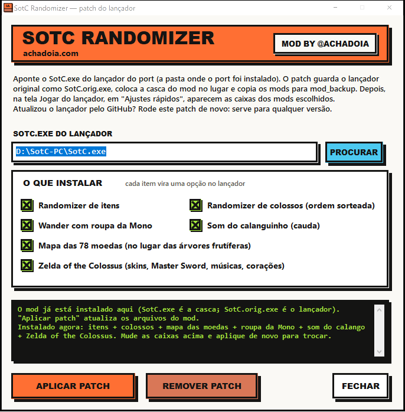
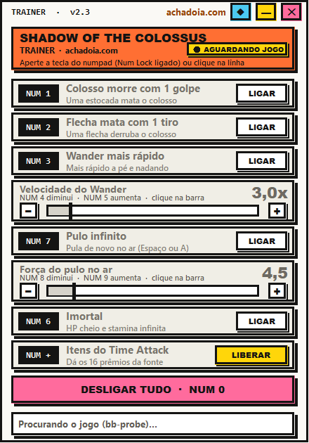

# Shadow of the Colossus PC — Randomizer, Trainer e mods

Mods para o port nativo de PC de *Shadow of the Colossus* (remake de PS4, EU 1.01, `CUSA08809`) do projeto [AjncSystem/ShadowOfTheColossus-PC](https://github.com/AjncSystem/ShadowOfTheColossus-PC): **randomizer de itens e de colossos**, **trainer**, mapa das 78 moedas e o pacote **Zelda of the Colossus**. Tudo se instala por um patcher de um clique e aparece como opções dentro do próprio lançador do port.

> **Este repositório não contém o jogo nem arquivos extraídos dele**, nem os assets de terceiros usados pelos mods visuais e de áudio (skins, músicas, texturas, sons). Só o código-fonte, os dados de coordenadas e os binários que compilamos. Você precisa do port já instalado e funcionando com o seu próprio jogo. Projeto de fãs, não afiliado à Sony, Bluepoint, Team Ico nem Nintendo. Licença do código: MIT.

<p align="center">
 
</p>

## O que tem aqui

| Mod | O que faz |
|---|---|
| **Randomizer de itens** | Os 16 prêmios da fonte do santuário (os do Time Attack) são sorteados ao longo da campanha: o 1º colosso dá 2, do 2º ao 15º dá 1 cada. O item aparece aceso na fonte e você vai buscá-lo. Se o jogo não entrega nada naquele slot (slot "invisível"), o randomizer entrega depois que a cutscene acaba. Nunca entrega item que você já tem. |
| **Randomizer de colossos** | A ordem dos 16 colossos é sorteada a cada jogo novo. A luz da espada aponta para o colosso certo, as lutas e cutscenes funcionam, e o final só acontece depois do 16º. Matar Malus cedo não dispara o final (Agro volta). A cena de chegada ao santuário é a da k-ésima morte, na ordem original. |
| **Mapa das 78 moedas** | Troca o mapa das árvores frutíferas pelas 78 moedas secretas (as relíquias douradas). Só mostra as que estão até 250 m de você e esconde as já coletadas. As posições (`data/moedas.txt`) foram calibradas sobre o mapa do jogo. |
| **Trainer v2.3** | Colosso morre com 1 golpe, flecha mata com 1 tiro, Wander mais rápido, velocidade ajustável, pulo infinito com força ajustável, imortal (HP cheio e stamina infinita), liberar os 16 itens do Time Attack. Teclado numérico (`NUM 1`…`NUM +`, `NUM 0` desliga tudo) ou clique. |
| **Zelda of the Colossus** | Wander vira Link, Mono vira Zelda, Master Sword, trilha sonora por região, corações de 20 HP e roda de stamina estilo Zelda (sobreposição). **O código está aqui; as skins, músicas e texturas não** (veja "Assets"). |
| **Roupa da Mono / som do calanguinho** | Troca de materiais e de um som por arquivo. Só o mecanismo (`psarc`) está aqui. |
| **Marca d'água** | "Mod by: @AchadoIA" nas telas de título e carregamento (some quando Wander existe). |

### Como o randomizer funciona (resumo)

O port roda o `eboot` do PS4 traduzido. O mod instala pequenos trechos de código (code caves) em memória e escreve flags de jogo:

- `FirstAliveBoss` (0x7D1A70) é redirecionado para percorrer a ordem sorteada; `KillBoss` (0x7D1700) conta mortes reais;
- itens entram pelo `FlagGet` (cave com caixa de correio) para rodar na thread do jogo, e as flags `LIGHT`/`START_CAM` acendem a fonte;
- cutscenes ativas seguram qualquer pedido ao jogo (o jogo trava se mexemos em flags durante a câmera de cutscene).

Os endereços valem **só** para o eboot `CUSA08809` 1.01. As notas completas de engenharia reversa (tabela de colossos, nomes de flags, fonte, mapa, HUD, causas de crash) estão em [docs/NOTAS-DE-ENGENHARIA.md](docs/NOTAS-DE-ENGENHARIA.md).

## Instalação

1. Tenha o port instalado e rodando (testado com a versão **0.70**).
2. Baixe da aba **Releases**: `SotC-Trainer.exe`, `SotC-Randomizer.exe`, `psarc.exe` e o patcher.
3. Rode o **patcher** (`SotC-Randomizer-Patch.exe`), aponte para o `SotC.exe` do lançador e marque os mods. Ele guarda o lançador original como `SotC.orig.exe`, instala a casca do mod e copia os arquivos para `mod_backup\`. Em seguida, na tela *Jogar* do lançador, aparecem as caixas dos mods.
4. Atualizou o port? O updater sobrescreve o `SotC.exe`: **rode o patcher de novo**. Há também "Remover patch", e o modo silencioso `--apply/--remove <SotC.exe>`.
5. O trainer (`SotC-Trainer.exe`) pode ser aberto antes ou depois do jogo; ele espera o processo do port.

## Compilar

Precisa só do `csc` do .NET Framework 4 que já vem no Windows (`C:\Windows\Microsoft.NET\Framework64\v4.0.30319\csc.exe`).

```
:: randomizer (motor dos mods)
csc /codepage:65001 /platform:x64 /target:exe /r:System.Windows.Forms.dll /r:System.Drawing.dll /out:SotC-Randomizer.exe src\standalone.cs src\randomizer.cs src\zeldahud.cs src\marca.cs src\neo.cs
:: trainer
csc /codepage:65001 /platform:x64 /target:winexe /r:System.Windows.Forms.dll /r:System.Drawing.dll /win32icon:src\achadoia.ico /out:SotC-Trainer.exe src\trainer.cs src\neo.cs
```

O patcher (`src/patcher.cs`) embute o lançador-casca, `launcher_mod.py`, o randomizer, o `psarc.exe` e um `mods.zip` com os arquivos de assets, que **não distribuímos**. Para gerar o seu, monte esse zip com os seus próprios arquivos (veja as notas de engenharia) e use `/resource:` como no fim do documento de notas. Sem o `mods.zip` você ainda pode usar o randomizer, o trainer e o mapa de moedas.

## Assets que não estão aqui

Skins do Link/Zelda, Master Sword, músicas, ícone de moeda no mapa e os arquivos das trocas de roupa/som são material de terceiros ou derivado dos arquivos do jogo. Faça os seus e coloque em `mod_backup\mods\...` e `mod_backup\musicas_zelda\`.

## Estado e problemas conhecidos

É um projeto experimental feito por tentativa e engenharia reversa.

- **Crashes**: o port já tem bugs de heap/GPU que derrubam o jogo (veja os logs em `shadow\crashes`). Nos testes ao vivo houve quedas na volta ao santuário após matar colossos, em parte atribuídas ao port e em parte a versões antigas dos mods. Faça backup do save (`saves_*`).
- A entrega de item em slot invisível passou a esperar o fim da cutscene (v2.18); **ainda não foi testada ao vivo**.
- O modo Reminiscência/Time Attack é ignorado pelo randomizer, mas a lógica foi pouco exercitada.
- Não use debugger no processo `bb-probe`: derruba o jogo.
- Os endereços são do eboot EU 1.01; outras versões não funcionam.
- Hardware de teste: Ryzen 5 2600X + Radeon RX 9060 XT, ~20–28 FPS com o modo PS4 Pro.

## Créditos

Port: [AjncSystem/ShadowOfTheColossus-PC](https://github.com/AjncSystem/ShadowOfTheColossus-PC). Mods, trainer e interface: [achadoia.com](https://achadoia.com) · @AchadoIA. Ferramentas de áudio baseadas no formato SNDX documentado pelo vgmstream.

